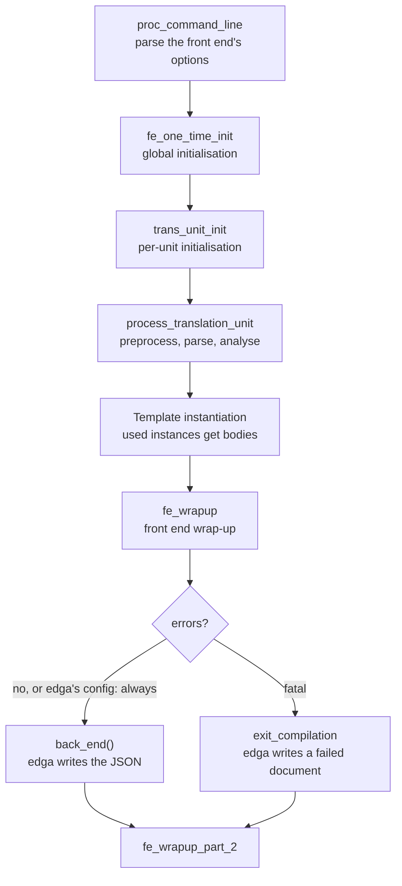
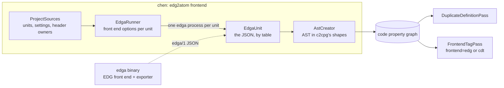

# How EDG and edga work

edga runs the EDG C/C++ front end on one translation unit and writes the program it
built as JSON. This document explains where that JSON comes from: what the EDG front
end is and how it turns text into an intermediate language, how edga embeds the front
end and walks that intermediate language, and how chen and atom turn the result into a
code property graph. It is written for a reader who wants to understand the pipeline
end to end, with pointers into the source rather than paraphrases of it.

A companion document, [edg-versus-cdt.md](edg-versus-cdt.md), compares this front end
with the Eclipse CDT parser that chen also offers.

## The EDG C/C++ front end

### What it is

The EDG front end is a commercial-grade C and C++ compiler front end developed by
Edison Design Group over nearly four decades. Its business model for most of its life
was licensing: compiler vendors and tool vendors bought it and built their back ends,
optimisers and analysis engines on top of it. On September 30, 2026 its source was
published at [github.com/edgcpp/compiler](https://github.com/edgcpp/compiler) under the
Apache License 2.0 with LLVM exceptions, with The C++ Alliance as its fiscal sponsor.
The version edga pins (recorded in `src/version.h` of the submodule) is 7.0, dated
September 28, 2026.

Two properties of the front end matter for edga. First, it aims for parsing
compatibility and bug emulation: source that compiles with GCC, Clang or MSVC should be
accepted, quirks included, and the front end has command-line modes that emulate each
compiler and version (`--gcc --gnu_version=...`, `--clang --clang_version=...`,
`--microsoft --microsoft_version=...`). Second, it is a full semantic analyser, not a
syntax checker: by the time parsing finishes, every expression has a type, every name
has a resolution, implicit conversions and compiler-generated code exist as explicit
nodes, and templates have been instantiated. The front end's own README summarises the
goal as producing an intermediate language tree "from which a back end can generate
object code".

### The intermediate language

The front end's output is the IL, a tree-structured in-memory representation of the
translation unit. Its design, described in `doc/source/il.rst` of the EDG repository,
follows three rules that show through in everything edga writes:

The IL is high-level. Its constructs correspond to C and C++ constructs as written: a
range-based `for` stays a range-based `for`, a `new` expression stays a `new`
expression with its allocation, count and initialisation attached. An optional IL
lowering pass can rewrite C++ constructs down to the C subset of the IL for back ends
that only handle C; edga builds with `DO_IL_LOWERING=0`, so the IL it reads keeps the
source shape.

Implicit transformations are made explicit. The conversion in `long l = i;`, the `!= 0`
test an `if` performs on a condition, the `this` pointer of a member call, the
temporaries and destructor calls at the end of a full expression: all exist as IL nodes
the front end created, marked as compiler-generated. edga keeps them and marks them
`"implicit"`.

Source correspondence is preserved. Every declaration, statement and expression carries
positions, and because preprocessing is integrated into parsing, positions survive
macro expansion: a node from expanded code says both where the expansion landed and
where the text was actually written (the macro definition or the invocation argument).
This is what makes edga's macro provenance possible, and it exists in the IL because the
front end uses it to generate symbolic debugging information.

Memory is managed in regions: a file-scope region that is always resident, plus one
region per function so that the IL of functions not currently being processed can live
outside memory. edga reads the IL directly in memory, so it never pays attention to the
region scheme, but the design explains why the IL scales to very large translation
units.

### One translation unit, step by step

The driver lives in `src/cfe.c` of the EDG sources. In the configuration edga uses,
one invocation of the front end processes exactly one translation unit, and the phases
are these (see `doc/source/admin.rst`, "Administrative Functions"):



Preprocessing is not a separate pass: the preprocessor runs on the fly as the parser
asks for tokens, following `#include` directives into header files, maintaining macro
definitions, and recording the tree of macro invocations. Parsing itself is recursive
descent, written by hand, with a precedence-climbing scheme for expressions so that a
simple expression does not cost a subroutine call per precedence level
(`doc/source/int_overview.rst`, "Recursive Descent Parsing"). As the parser works it
builds the IL and the symbol table, and performs full semantic analysis: overload
resolution, template argument deduction and instantiation, access checking, constant
folding. For a C++ unit, the front end can also run automatic template instantiation
driven by a prelinker across translation units; edga instead asks for
`--instantiate used` with automatic instantiation off, so a header's template instances
appear in every unit that uses them, which is what a single-unit exporter needs.

### A configurable front end

Nearly every behavioural decision in the front end is a compile-time configuration
macro (hundreds of them, set through EDG's `macro-conf` system). Two consequences run
through edga:

The front end is embeddable. `MAKE_FRONT_END_CALLABLE=1` turns the front end's `main`
into an ordinary function whose name the `EDG_MAIN` macro chooses (`edg_main` by
default), and a configuration with `BACK_END_SHOULD_BE_CALLED` on while both
EDG-supplied back ends (`BACK_END_IS_C_GEN_BE`, `BACK_END_IS_CP_GEN_BE`) are off makes
`cfe.c` declare and call an external `back_end()` function that the embedding program
defines. This is the same integration model EDG's commercial licencees used.

Enumerator values vary by configuration. The numeric values of IL kind enums
(statement kinds, expression operator kinds, type kinds) depend on the configuration.
That is why edga never writes numbers for kinds: `tools/gen_il_names.py` generates a
name switch for each enum from EDG's `il_def.h`, keeping its preprocessor conditionals,
and the back end writes kinds by name (`"k": "if"`, `"op": "indirect_field_access"`).
A document from any build describes itself in words that do not depend on how the
front end was configured.

## edga, the exporter

### EDG as a library

edga compiles the front end's sources unmodified, from a git submodule pinned to one
commit, into a static library, and adds three source files of its own
(`src/edga_main.cpp`, `src/edga_back_end.cpp`, `src/sarif_reader.cpp`). The
configuration edga adds on top of EDG's platform defaults
(`config/macro-conf/common.cmakedef`) says, in effect: the exporter is the back end,
there is no generated C or C++, no lowering, one translation unit per run, and the
back end runs when the code has errors too.

The main program takes edga's own options out of the argument list and passes
everything else to the front end:

```
main()                          src/edga_main.cpp
  strip --edga-out/--edga-root/--edga-headers
  add defaults the user did not give:
    --no_remove_unneeded_entities   keep bodies nothing calls
    --instantiate used              instances the unit uses get bodies
    --no_auto_instantiation         ... without the prelinker
    --error_limit 1000000           keep going past many errors
    --output_mode sarif             diagnostics as a file edga can read
    --template_info_file <temp>     never write next to read-only sources
  edg::edg_main(argc, argv)      the front end, as a library
    process_translation_unit()    preprocess, parse, analyse
    back_end()                    src/edga_back_end.cpp, the exporter
  read the SARIF log and the front end's early stderr
  finishUnit() or writeFailedUnit()
```

Two details are worth noticing. `--clear_flag=use_predefined_macro_file` is set
because edga is a single binary with no EDG installation around it: the caller
supplies the compiler's predefined macros (chen passes them with
`--preinclude_macros`, collected from the project's own compiler). And the back end
runs even when the unit had errors (`CALL_BACK_END_EVEN_WITH_ERRORS=1` in edga's
configuration), so a half-digested unit still exports the parts the front end could
build.

### The document

`back_end()` in `src/edga_back_end.cpp` walks the IL and writes one JSON object,
streaming through `src/json_writer.h` so a unit of any size takes constant memory to
emit. The shape is fixed by `schema/edga-1.schema.json`, and the golden tests in
`tests/expected` pin it down:

```json
{
  "schema": "edga/1",
  "tool":   { "name": "edga", "version": "...", "edgCommit": "...", "config": "..." },
  "tu":     { "path": "...", "language": "c++", "status": "ok", "mode": { ... } },
  "files":  [ { "id": 0, "path": "...", "system": false, "inRoot": true, "includedFrom": [0, 12] } ],
  "macros": [ { "id": 1, "name": "MIN", "objectLike": false, "text": "#define MIN(a,b) ...", "p": [0, 4, 9] } ],
  "macroInvocations": [ { "id": 2, "parent": 1, "macro": 1, "name": "MIN", "start": [0, 5, 26], "end": [0, 5, 44] } ],
  "inlineNamespaces": [ "std::__1" ],
  "globals":  [ { "id": 5, "name": "limit", "type": 3, "storage": "static", "init": ... } ],
  "routines": [ { "id": 1, "qualifiedName": "clamp_size", "type": 0, "returnType": 8,
                  "params": [ ... ], "ctorInits": [ ... ], "body": { "k": "block", "stmts": [ ... ] } } ],
  "types":    [ { "id": 0, "kind": "routine", "name": "int (int)", "returns": 5, "params": [ 3 ] } ],
  "diagnostics": [ { "level": "warning", "code": "EC47", "message": "...", "file": "...", "line": 8 } ]
}
```

What is shared is flat, in tables joined by id: files, macros, invocations, globals,
routines, types. What is hierarchical is nested: each routine's parameters,
constructor initialisers and body form a tree of statements and expressions, because a
body is read as a whole and a table for it would be all indirection. The routines
table grows while it is being written, because writing a call expression notes the
callee, and the callee's own entry (which may live in a header or another scope the
initial walk did not reach) is then written too.

Everything the front end resolved is in the tree with the resolution attached: an
operation node names its operator by kind, a call says which routine it resolved to,
a `new` says which allocation routine and which type it allocates, a constant carries
its value and, when the front end folded it from an expression, the expression too
(`sizeof(p->data)` folded to 16 keeps both). Types are spelled the way the front end
prints them for diagnostics (`form_type` with the diagnostic output control), so
`std::__1::vector<int, std::__1::allocator<int>>` appears as the front end sees it,
with inline namespaces listed separately so a reader can also match the program's
spelling.

### Positions and macro provenance

A position is `[file id, line, column]`, and file ids are assigned in include order
with file 0 the primary source file. Nodes from macro-expanded code carry more:

```
"p"   where the node is, as the compiler sees the expansion (top-level invocation's position)
"mi"  the id of the innermost macro invocation the node came from
"po"  where the text was actually written: inside the macro's definition, or in an argument
```

The `macroInvocations` table is a tree: each invocation names its parent, so nested
expansions are reconstructible. For the fixture `tests/fixtures/macros.c`, with the
definitions on lines 3 to 5 and the use on line 9:

```
 3  #define LIMIT 16
 4  #define MIN(a, b) ((a) < (b) ? (a) : (b))
 5  #define CLAMP(v, lo, hi) MIN(MIN(v, hi), lo)

 9  int limited = CLAMP(requested, 0, LIMIT);
                       └───── invocation 1, parent 0 ─────┘
                                        └── invocation 2: LIMIT, parent 1, at 9:37
                                            (the argument's text, at the call site)
    invocations 3 and 4: the two MINs, parent 1, at 5:26 and 5:30
    (their text is written inside CLAMP's definition)
```

A consumer can therefore tell that the two `MIN` expansions came from CLAMP's
definition rather than from the call site, and that `LIMIT` came from the invocation's
argument. chen uses exactly this to build macro invocations as INLINED calls with
argument copies and to tag every node of an expansion with its invocation.

### Diagnostics and failure

The front end writes diagnostics to a SARIF file (a temporary one, by default, with
`--output_mode sarif --error_output <file>`), which `src/sarif_reader.cpp` reads back
after the front end finishes; errors reported before the SARIF log opens are captured
from standard error and parsed as SARIF text. The document then closes with them under
`diagnostics`, and the unit status is one of:

`ok` the front end reported no errors. `errors` it reported some, and the document
holds the parts it could build (an exporter that gives up on the first error would be
useless for analysis, where the code base is the input, not the deliverable). `failed`
the front end never reached the back end, for instance the primary file cannot be
opened; the document is then just the tool, the tu and the diagnostics. For the same
reason the back end writes to a temporary stream when the output is standard output
and copies it over only once the document is complete, so a crash never leaves half a
JSON file on stdout.

### Scope: root and headers

`--edga-root <dir>` says which part of the tree the analysis owns: function bodies are
exported only for non-system files under it, and a routine declared in the project but
defined elsewhere is written with `defined: false` and its declared parameters.
`--edga-headers` also exports bodies defined in headers outside the root. Files are
flagged `system` when they came from a system include directory, which is how the
consumer tells project code from libc and toolchain headers without pattern matching
on paths.

### Building and testing edga

The EDG sources are a submodule; `tools/fetch-edg.sh` fetches the pinned commit one
deep without the test suite, and CMake then compiles the front end's file list, read
out of EDG's own `src/CMakeLists.txt` so a submodule update brings new files along.
The front end's configuration for the host comes from `config/macro-conf`
(`linux-x86_64`, `linux-x86_64-musl`, `linux-aarch64`, `macos-arm64`,
`windows-x86_64`, `windows-arm64`), assembled with EDG's `edg-cmakedef` tool over a
root that links EDG's shared configurations next to edga's. The generated
`cmake_defines.h` is hashed into a configuration fingerprint that `--edga-version`
prints, so a consumer can tell whether two edga binaries interpret the language the
same way.

The tests run the binary over the fixtures and compare with `tests/expected`:

```bash
python3 tests/run.py --edga build/bin/edga            # compare
python3 tests/run.py --edga build/bin/edga --update   # rewrite
```

Each fixture declares what it uses instead of including system headers, so the expected
output does not depend on the host's C library, and the runner also validates every
output against `schema/edga-1.schema.json` when the `jsonschema` module is installed.
A `// edga-options:` line at the top of a fixture gives the front end options for it.

## edga in chen and atom

### The edg2atom frontend

chen (Code Hierarchy Exploration Net) is AppThreat's code analysis library, the core
behind the atom CLI; it represents a program as a code property graph. Its C/C++
support has two frontends that produce the same graph shapes: `c2cpg`, the default,
built on the Eclipse CDT parser, and `edg2atom`
(`platform/frontends/edg2atom` in the chen repository), built on edga. They share
everything that is not the parser: configuration, compilation database support, header
ownership, graph shapes and the passes that run afterwards, so queries and the
memory-safety rules work on either graph.



`Edg2Atom` orchestrates: it runs `EdgAstCreationPass` (a parallel pass over
translation units, each running one edga process with a timeout of ten minutes), then
`DuplicateDefinitionPass` (template instances from headers are written by every unit
that uses them; one copy is kept), then tags each FILE node with the frontend that
built it. With `fallbackToCdt`, the units edga could not export, and the project
headers belonging to them, are parsed by the CDT frontend into the same graph, and the
run reports which files those were and why the first failed.

### Driving the front end as the project's compiler

The interesting work in `EdgaRunner` is turning a unit's settings into front end
options that make EDG behave like the compiler the project actually uses:

The compiler is identified from its predefined macros, taken from a compilation
database when there is one, else the host's compiler (GCC or Clang; MSVC's macros come
from tables because `cl.exe` cannot list them). The macros decide the dialect options:
`--clang --clang_version=...` when the macros are Clang's, `--g++ --gnu_version=...`
for GCC, `--microsoft --microsoft_version=...` for MSVC. The macros themselves are
passed with `--preinclude_macros` as a generated file, minus those the front end owns
(`__STDC__`, `__cplusplus` and friends) and minus shims the parser settings needed but
a real front end does not.

The language standard maps to the front end's modes (`--c++17`, `--ms_c++14` for
MSVC's `/std:c++14`, `--c23`, and so on), and a GNU-family dialect chooses strict
versus GNU mode from whether the `-std` spelling names the ISO language, because an
ISO `__STRICT_ANSI__` would hide POSIX and GNU declarations in glibc headers.

Include directories from the build and the compiler's own system include directories
become `-I` and `--sys_include`. A small set of host shims deals with the world as
found: libc++ builds get `__OPTIMIZE_SIZE__` so its vectorised algorithms (built on
Clang-specific dependent-size vector types the front end cannot instantiate) stay out
of the unit, ARM NEON macro gates are not passed on because the front end does not
declare those intrinsics, and edga configurations built without float128 define
`_Float128` as `long double` where glibc headers expect the compiler's own type.

### Headers, caching and failure

Headers are never parsed on their own. Each project header belongs to the first
translation unit, in path order, that includes it, and is written as part of that
unit's graph, so every run writes it from the same place with the same settings. The
AST cache key holds the unit's fingerprint, the CRCs of the project headers it
includes, and edga's identity: the full `--edga-version` output (exporter version, EDG
commit, configuration fingerprint), so an AST from another edga build is never reused.

A unit that fails is visible, not silent: its file and the first error's message are
recorded, the headers it owned are listed as unwritten, and with fallback on, the CDT
frontend parses exactly those files.

### atom's part

The atom CLI exposes the choice as `--c-frontend <cdt|edg|edg-fallback>` (cdt is the
default) and finds the binary through `--edga-path`, `EDGA_PATH` or the `PATH`. atom's
container images install edga by pulling the release artifact published to
`ghcr.io/appthreat/edga` with oras, so `--c-frontend edg` works out of the box there.
Everything else in atom, the passes, the slices, the taint queries, is the same code
over the same graph whichever frontend built it.

## Points of reference

The table lists the places this document describes, for reading in context.

| What | Where |
|---|---|
| edga's main program and option handling | `src/edga_main.cpp` |
| the exporter (the back end) | `src/edga_back_end.cpp` |
| the document contract | `schema/edga-1.schema.json` |
| kind names generated from the IL enums | `tools/gen_il_names.py`, `src/il_names.inc` at build time |
| the configuration edga adds | `config/macro-conf/common.cmakedef` |
| the build, including the front end | `CMakeLists.txt`, `tools/fetch-edg.sh` |
| golden tests and the runner | `tests/run.py`, `tests/fixtures`, `tests/expected` |
| the front end's driver | `third_party/edgcpp/src/cfe.c` |
| the IL and its design | `third_party/edgcpp/src/il_def.h`, `doc/source/il.rst` |
| the front end's own overview | `third_party/edgcpp/doc/source/int_overview.rst`, `admin.rst` |
| the consumer in chen | `platform/frontends/edg2atom` in the chen repository |
| the shared frontend it mirrors | `platform/frontends/c2cpg` in the chen repository |
| the CLI that exposes the choice | `--c-frontend` in atom's `Atom.scala` |
